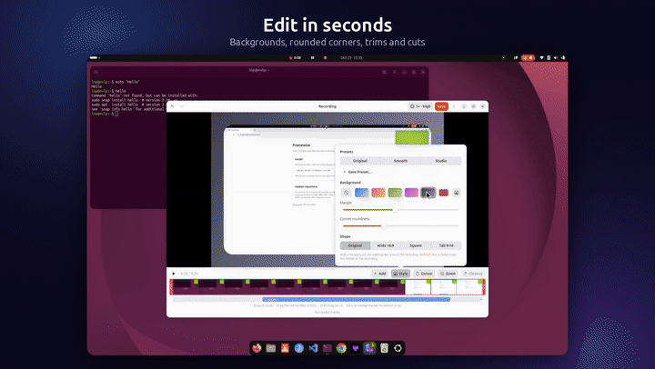

# Framewise

Screen recording, screenshots, text from the screen and clipboard history for
Ubuntu (GNOME). Brought to you by [@gitcotech](https://t.me/gitcotech).

<a href="https://buymeacoffee.com/framewise"></a>



- **Record** an area, a window or the whole screen, with system sound, your
  microphone (each on its own track) and a camera bubble. Then edit: trim and
  cut, silence and filler-word removal, noise reduction, auto zoom (clicks and
  typing), cursor effects, backgrounds, captions and images. Save as MP4 or GIF, at
  any speed or under a size limit.
- **Screenshots** of an area, a window or the screen, with a mark-up editor
  (arrows, text, counters, blur, redact, spotlight, crop, background, corner
  radius) and pinning.
- **Text capture (OCR)** from any part of the screen, in every installed language.
- **Clipboard history** of text, pictures and files, with search and pins.
- **Camera** bubble or mirror, with filters, background blur, skin smoothing
  and face lighting.

Everything runs on your computer. Nothing is uploaded. (Once a day Framewise
asks GitHub whether a new version is out; Settings → About turns that off.)

## Install

Needs Ubuntu 24.04 or newer with GNOME (made and tested on Ubuntu 26.04,
GNOME 50). In a terminal:

```bash
wget -qO- https://lnpaulin.github.io/framewise/install.sh | sudo bash
```

It adds the Framewise update repository and installs Framewise with apt,
which also brings what it needs (GStreamer, ffmpeg, Tesseract and so on).
[Read the script](packaging/site/install.sh) first if you like. Then:

1. Open **Framewise** from the app grid.
2. **Log out and back in once.** This turns on its GNOME extension: the menu
   at the top right, clipboard history and the recording controls.

<details>
<summary>The same, step by step</summary>

```bash
sudo wget -qO /etc/apt/keyrings/framewise.gpg https://lnpaulin.github.io/framewise/apt/framewise.gpg
sudo wget -qO /etc/apt/sources.list.d/framewise.sources https://lnpaulin.github.io/framewise/apt/framewise.sources
sudo apt update && sudo apt install framewise
```

Key fingerprint: `F69B 9995 8DF3 DE44 9A33 CABF 2B8D 94D1 92EA DC4F`.
</details>

<details>
<summary>Or with the .deb file</summary>

Download `framewise_1.0.5_all.deb` from
[Releases](https://github.com/LnPaulin/framewise/releases/latest), then:

```bash
sudo apt install ./framewise_1.0.5_all.deb
```

Use `apt`, not `dpkg -i`, so what Framewise needs is installed too. This also
sets up updates.
</details>

**Updates** arrive in Ubuntu's Software Updater, like system updates: the
package adds the Framewise update repository (signed; see
[lnpaulin.github.io/framewise](https://lnpaulin.github.io/framewise/)).
Framewise restarts itself quietly after an update. If the update includes a
new GNOME extension, it tells you to log out and back in.

To remove it: `sudo apt remove framewise` (`sudo apt purge framewise` also
removes the update repository).

## Use

| Shortcut | What it does |
| --- | --- |
| Shift+Super+R | Record (again to stop) |
| Shift+Super+S | Screenshot |
| Shift+Super+T | Capture text (OCR) |
| Shift+Super+V | Clipboard history |
| Shift+Super+C | Toggle camera |

Super is the Windows key. Change or turn off any shortcut in Settings →
Shortcuts. Like a menu-bar app, Framewise keeps running after its windows
close, with its icon at the top right, until you choose **Quit Framewise**
there. Turn on **Launch at login** in Settings → About to have it from boot.

## Optional extras

- **Filler words ("um", "uh")**: the editor offers to download speech
  recognition the first time (about 600 MB, once). Remove it in Settings.
- **More languages for text capture**: install the language pack, for example
  `sudo apt install tesseract-ocr-fra` for French.
- **Camera effects** need `python3-opencv` (installed with Framewise unless
  you skipped recommended packages).

## Troubleshooting

- **No menu at the top right, no clipboard history**: log out and back in
  once after installing. Check Settings → About → GNOME extension.
- **High CPU while recording**: Settings → About → Video acceleration says whether
  hardware encoding is used. Intel and AMD graphics are (VA-API); others record
  in software, which works but uses more CPU. Try 30 fps or
  Balanced quality in Settings → Recording.
- **"Can't record"**: Ubuntu asks for permission to share the screen; choose
  the display and allow it. "Reset screen permissions" in Settings resets it.

GNOME 46 to 50 are supported; 50 is tested. Other desktops (KDE and so on)
can record through the standard screen-sharing portal, but the top-bar menu,
clipboard history and some screenshot features need GNOME.

## Build the package

```bash
scripts/build-deb.sh          # makes dist/framewise_<version>_all.deb
```

For development, `scripts/install.sh` links your home folder to this
checkout instead (`scripts/uninstall-dev.sh` undoes that).

## Support

Framewise is free and open source, and it will stay that way. If it saves you
time, a [coffee](https://buymeacoffee.com/framewise) helps keep it going.
Updates are posted on [Telegram](https://t.me/gitcotech).

## Licence

GPL-3.0-or-later (see LICENSE). Its features follow
[Vorssaint](https://github.com/vorssaint/vorssaint-utils) (GPL-3.0). Bundled
models: YuNet face detection (MIT, OpenCV), MediaPipe selfie segmentation
(Apache-2.0, Google), RNNoise models (not copyrighted).
